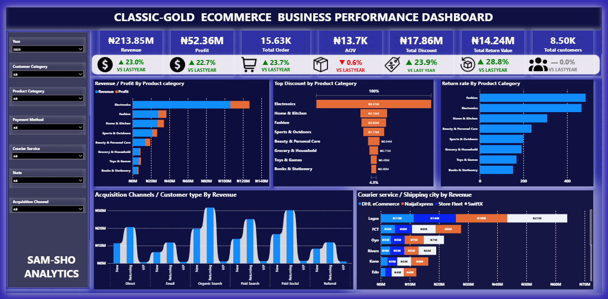

# ecommerce-business-performance-analytics
E-commerce Business Performance Analytics using Power BI – Executive, Sales, Marketing &amp; customer retention and Inventory Dashboards.
# CLASSIC-GOLD | E-commerce Business Performance & Operational Analytics

**An End-to-End Business Intelligence Case Study**

**Prepared by:** Samuel Shobowale, ACA  
**Industry:** E-commerce / Retail  
**Reporting Period:** 2024–2025  
**Tools:** Microsoft Power BI, Power Query, DAX and Excel

---

## 1. Project Overview

This project examines the commercial and operational performance of CLASSIC-GOLD, a simulated e-commerce business, using an integrated Business Intelligence approach.

The analysis covers four major business areas: Executive Business Performance, Sales Performance, Marketing Effectiveness and Inventory Management.

The objective is to transform raw business data into meaningful insights that help management evaluate performance, identify operational gaps, understand business trends and make informed decisions.

## 2. Dashboard Preview

The project features four interactive Power BI dashboard pages.

### 01. Executive Business Performance

.

Provides an overview of overall business performance, highlighting revenue, profitability, order volume, customer contribution and key performance trends.

### 02. Sales Performance

Examines revenue growth, product and category performance, customer purchasing behaviour, sales channels and regional performance.

### 03. Marketing Performance

Evaluates marketing expenditure, customer acquisition, advertising effectiveness, conversion performance and return on advertising spend.

### 04. Inventory Performance

Monitors inventory movement, stock replenishment, product returns and inventory-related operational performance.

**[View Interactive Power BI Dashboard](https://77qe7rr.s.gy/ecommerce_dashboard_project)**

---

## 3. Business Problem and Objectives

E-commerce businesses operate across interconnected commercial and operational functions. Limited visibility into sales performance, marketing efficiency and inventory movements can affect revenue generation, customer acquisition and operational efficiency.

This project addresses the need for an integrated reporting solution that provides visibility across these business functions.

**Key Analytical Objectives**

- Evaluate overall business performance and revenue trends.
- Identify sales patterns across products, categories, regions and channels.
- Assess marketing expenditure and customer acquisition effectiveness.
- Evaluate inventory movement, stock availability and replenishment patterns.
- Provide actionable recommendations for improving business performance.

## 4. Dataset Overview

The analysis uses a synthetic e-commerce dataset designed to simulate real-life business transactions and operational activities across the 2024–2025 reporting period.

The dataset covers:

- Sales transactions
- Customer information
- Product information
- Marketing expenditure
- Inventory movements
- Product returns

The dataset was reviewed and prepared for analysis through data quality checks, standardisation, data type corrections and transformation.

## 5. Tools and Technologies

| Tool | Application |
|---|---|
| Microsoft Power BI | Interactive dashboards and data visualisation |
| Power Query | Data cleaning and transformation |
| DAX | KPI calculations and analytical measures |
| Microsoft Excel | Dataset preparation and supporting analysis |

## 6. Data Modelling and Analytical Approach

The project adopts a Star Schema data model, separating transactional data from descriptive business information.

**Fact Tables**

- FactSales – Sales transactions, revenue, profit and quantities sold.
- FactReturns – Product return transactions and return quantities.
- FactInventory – Opening stock, replenishment, units sold and closing stock.
- FactMarketing – Marketing expenditure and acquisition costs.

**Dimension Tables**

- DimDate – Calendar, month, quarter and year.
- DimProduct – Product names, categories and brands.
- DimCustomer – Customer details and segments.
- DimChannel – Marketing and acquisition channels.
- DimShipment – Courier services and shipping locations.

The model primarily uses one-to-many relationships and single-direction filtering.

**Analytical Methodology:** Descriptive analytics was applied to examine historical business performance, identify trends, evaluate patterns and highlight areas requiring management attention.

## 7. Key Performance Indicators (KPIs)

The analysis incorporates the following performance indicators:

- Total Revenue
- Revenue Growth (%)
- Average Order Value (AOV)
- Marketing Spend
- Customer Acquisition Cost (CAC)
- Click-Through Rate (CTR)
- Conversion Rate
- Return on Advertising Spend (ROAS)
- Product Return Rate
- Stock Replenishment Rate

## 8. Key Business Findings

The 2025 analysis revealed the following important business insights:

**1. Revenue Growth Was Primarily Volume-Driven**

Revenue, profit and order volume increased year-on-year despite a relatively stable customer base. Returning customers contributed 64% of total revenue. However, declining Average Order Value (AOV) suggests that customers were placing more orders but spending less per transaction.

**2. Marketing Returns Improved Amid Rising Acquisition Costs**

Advertising engagement and Return on Advertising Spend (ROAS) improved, with Paid Search and Paid Social leading advertising-attributed revenue. However, increasing Customer Acquisition Cost (CAC) and declining conversion rates indicate potential weaknesses in converting advertising engagement into completed purchases.

**3. Inventory Improvement Was Offset by Increasing Product Returns**

The stock replenishment rate improved marginally to 69.65%, representing a 0.01 percentage-point increase over 2024. However, product returns increased by 28.8% year-on-year, with Electronics and Fashion recording the highest return rates. Unclear product descriptions and fulfilment or delivery damage were major reported return drivers.

## 9. Business Recommendations

Based on the findings, the following management actions are recommended:

| Business Area | Recommended Action |
|---|---|
| Sales | Improve AOV through cross-selling, upselling, product bundling and targeted promotions. Strengthen customer retention initiatives. |
| Marketing | Optimise advertising expenditure across channels, monitor CAC against customer lifetime value and investigate declining conversion rates. |
| Inventory | Improve demand-based replenishment planning, product descriptions, quality checks, packaging and delivery handling. |
| Management | Establish periodic performance reviews to monitor profitability, customer retention, marketing efficiency and inventory performance. |

**Overall Priority:** Balance revenue growth with customer value, marketing efficiency and inventory effectiveness to support sustainable business performance.

## 10. Analysis Limitations and Assumptions

- **Synthetic Dataset:** The dataset is synthetically generated and may not fully reflect the complexities of actual business operations.
- **Data Accuracy:** Findings depend on the accuracy, consistency and completeness of the available dataset.
- **Limited Business Context:** External factors such as competitor activities and broader economic conditions were not independently assessed.
- **Limited Causal Evidence:** Observed relationships and historical trends do not independently establish cause-and-effect relationships.
- **Predictive Limitations:** Historical performance does not guarantee future business outcomes.

## 11. Project Deliverables

| Deliverable | Access |
|---|---|
| Interactive Power BI Dashboard | [View Dashboard](https://77qe7rr.s.gy/ecommerce_dashboard_project) |
| Power BI Project File (.pbix) | [View Dashboard Folder](Dashboard/) |
| Project Dataset | [View Dataset Folder](Dataset/) |
| Supporting Documentation | [View Documentation Folder](Documentation/) |
| GitHub Repository | [View Project Repository](https://github.com/Sam-Sho-Analytics/ecommerce-business-performance-analytics) |

## 12. About the Author

**Samuel Shobowale, ACA**

Business Intelligence and Data Analytics | Accounting & Financial Analytics

I am interested in using data analytics and business intelligence to transform business data into meaningful insights that support better financial, commercial and operational decisions.

**Connect with me:**

- [LinkedIn](https://www.linkedin.com/in/samuelshobowale/)
- [GitHub](https://github.com/Sam-Sho-Analytics)
